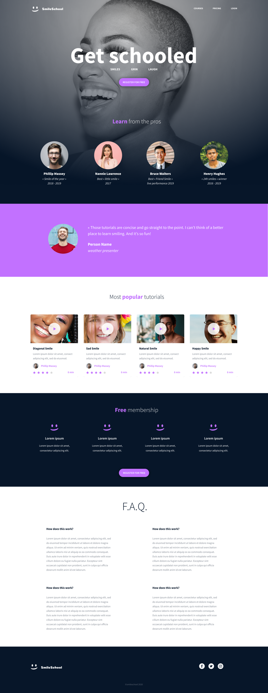

# SmileSchool - CSS, advanced

A responsive-ready landing page for **SmileSchool**, built from a Figma design using only HTML and CSS (no libraries or frameworks).

This project follows the *HTML, advanced* project: the markup is the same page, and this time the focus is the style.

## What is on the page

- **Header and banner**: logo, navigation links, "Get schooled" title, call to action and the four teachers
- **Quote**: testimonial with a round photo
- **Popular tutorials**: video cards with a play icon, author, stars and duration
- **Free membership**: four benefits in a row and a call to action
- **F.A.Q.**: 2x2 grid of questions
- **Footer**: logo, social links and copyright

## Design

## Result

## Concepts practiced

- Selectors, classes and CSS specificity
- The box model (margin, padding, border)
- Flexbox and CSS Grid for layout
- Background images and gradients
- Pseudo-elements (the video play icon and the membership smileys)

## Files

| File | Purpose |
|---|---|
| `index.html` | The page markup |
| `styles.css` | All the styling |
| `images/` | Logos, photos and icons |

## Live demo

https://YOUR_USERNAME.github.io/alu-web-development/css_advanced/

## Author

Your Name - ALU Web Development
